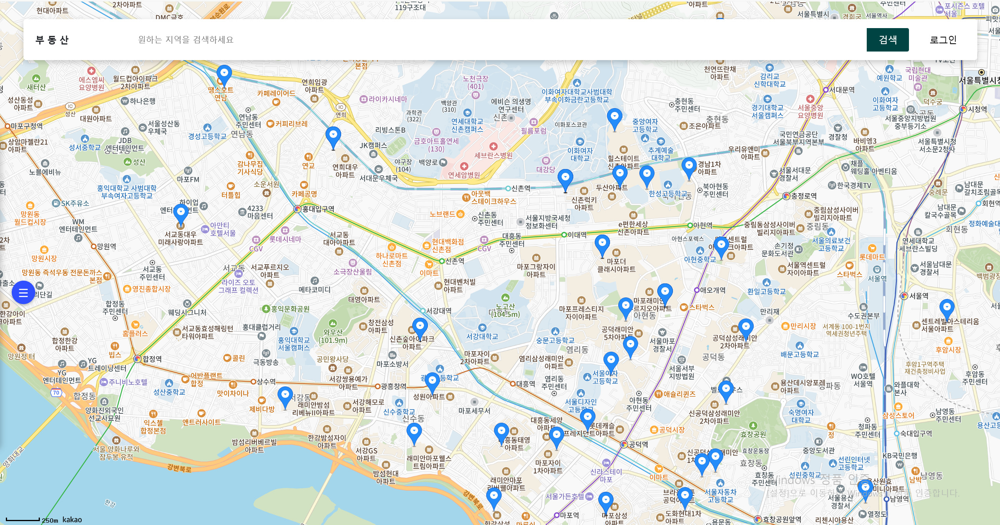
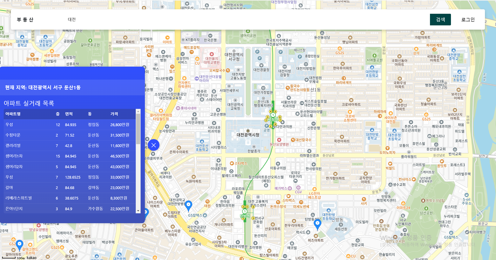
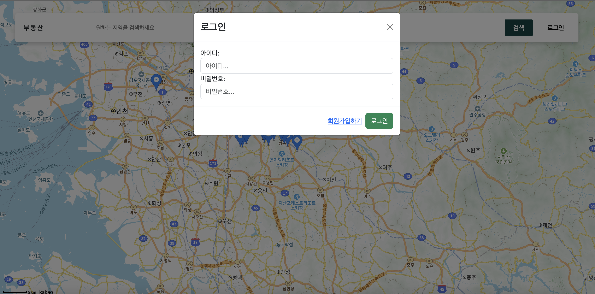
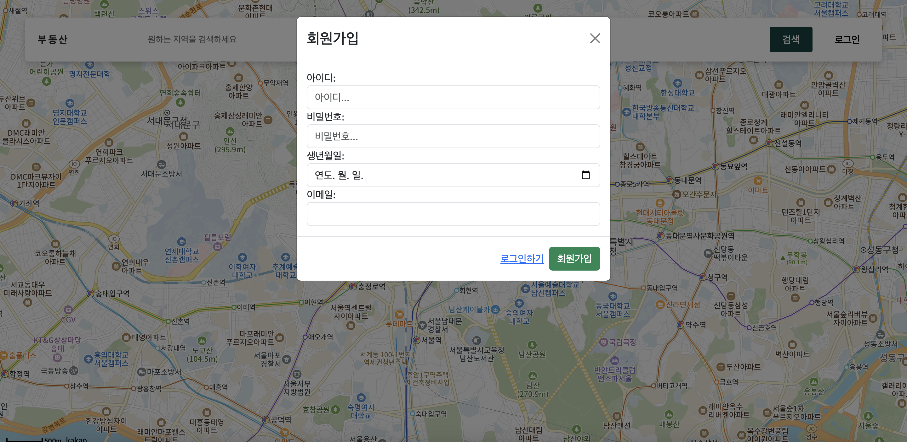
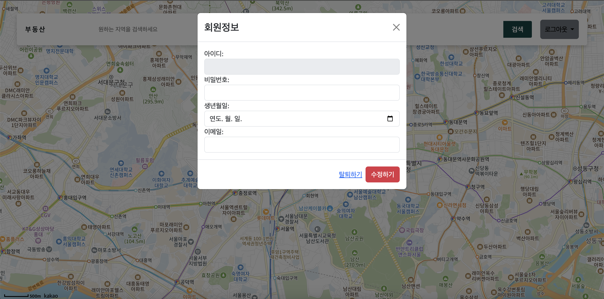

# 🏡 부동산 웹사이트 - SSAFY BE 관통 프로젝트

이 프로젝트는 **SSAFY SpringBoot 관통 프로젝트**로, **부동산 웹사이트**를 주제로 제작되었습니다.  
사용자 중심의 UI와 위치 기반 서비스를 통해 실시간으로 부동산 정보를 제공하는 웹 애플리케이션입니다.

---

## 🚀 주요 기능

### 🔍 전체 조회 (위치 기반 내역 표시)

- 사용자의 **현재 위치**를 기준으로 주변 부동산 내역을 조회할 수 있습니다.

### 🗺️ 검색 조회 (키워드 기반 지도 이동)

- 검색한 키워드를 입력하면 해당 위치로 지도가 이동하며, 관련 정보를 확인할 수 있습니다.

### 👤 회원 기능

#### 🔑 로그인

- 이메일과 비밀번호를 입력하여 로그인할 수 있습니다. 로그인 여부를 구분하여 기능에 제약을 둡니다

#### 📝 회원가입

- 새로운 계정을 생성할 수 있습니다.

### ⚙️ 마이페이지

- 사용자는 마이페이지에서 개인정보 조회, 수정, 탈퇴 기능을 이용할 수 있습니다.

## 🛠 사용 기술 (Tech Stack)

- **Frontend** :
- **Backend**: Spring boot, jsp
- **Database**: MySQL
- **API**: 공공데이터포털 부동산 API , kakao API

---
